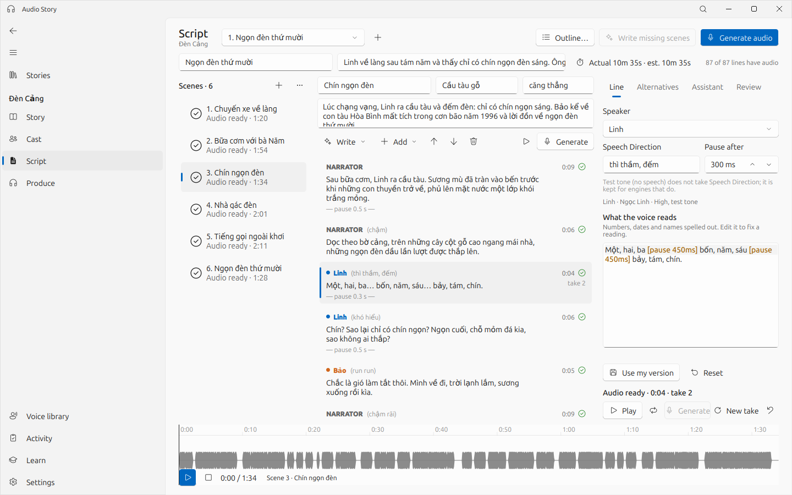
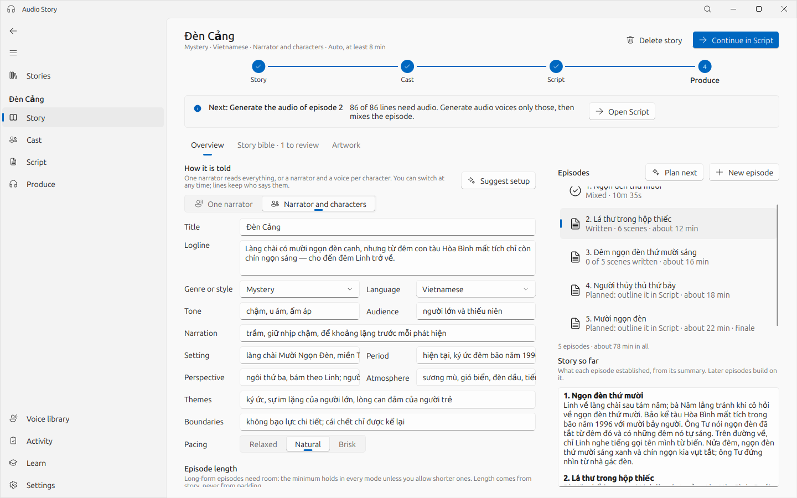
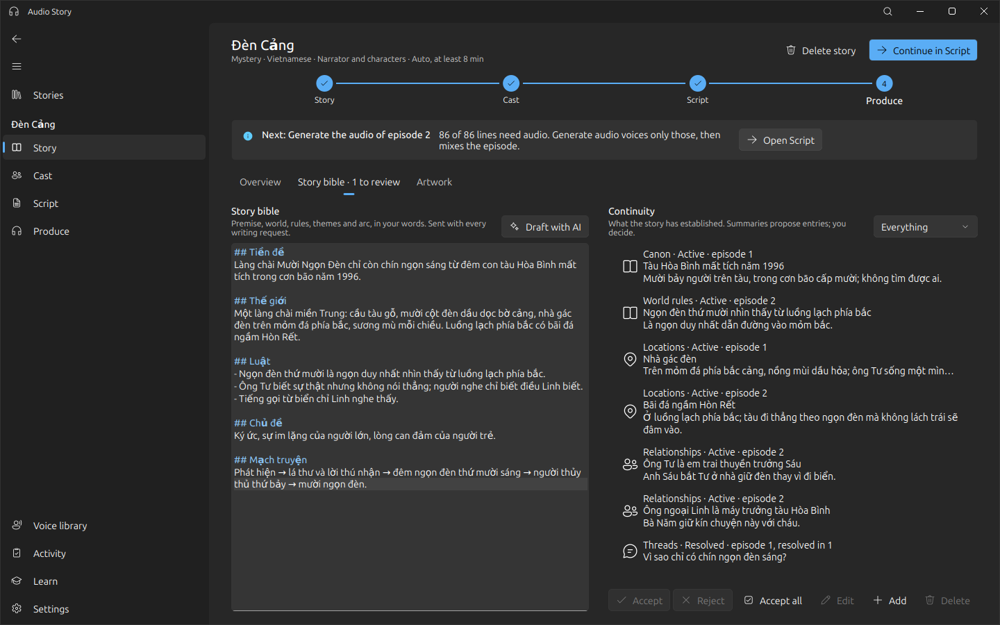
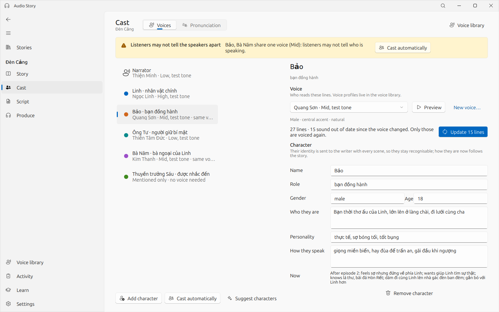
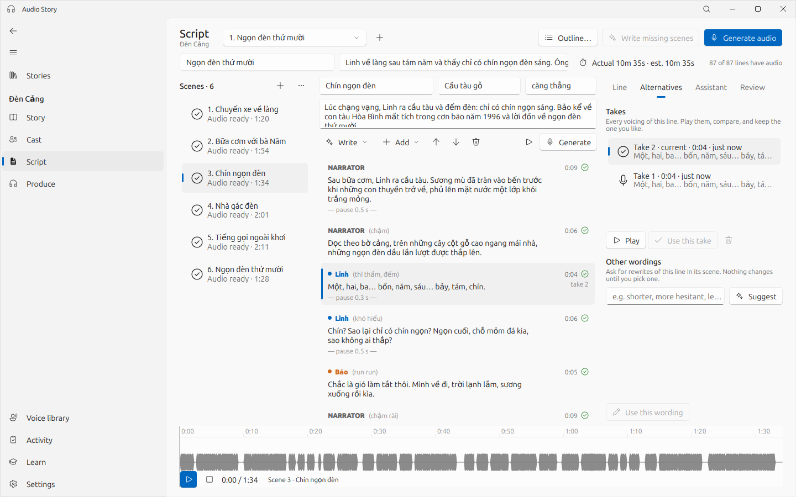
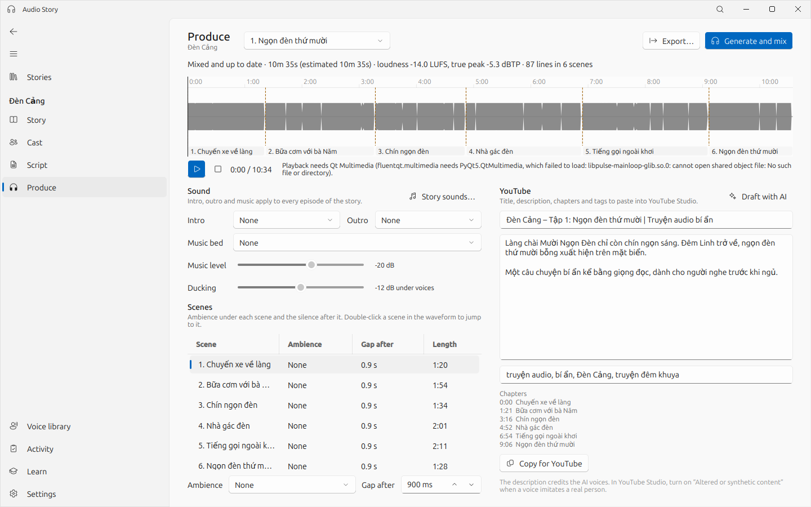
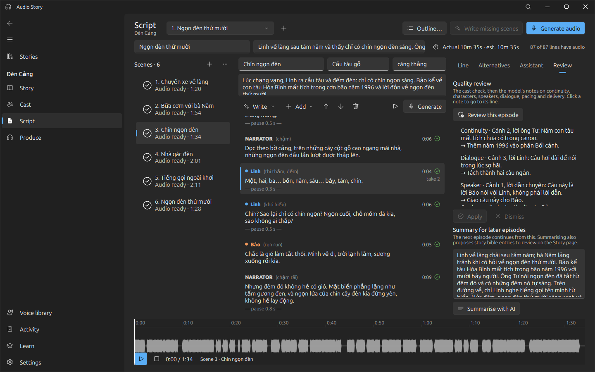
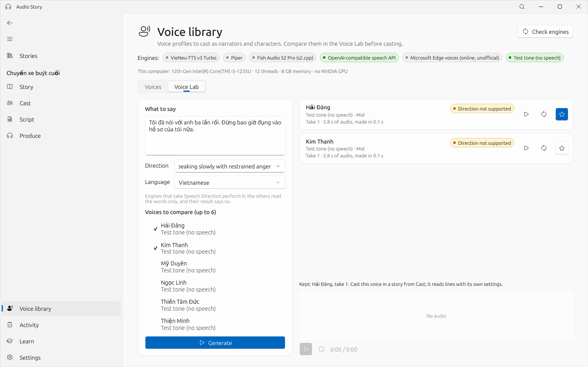
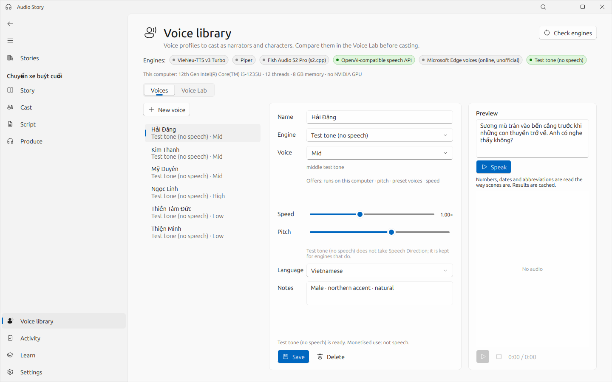
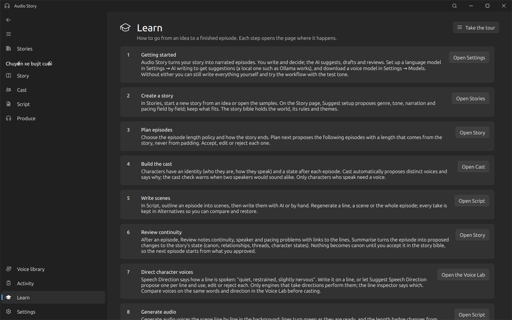

# Audio Story

**An AI-assisted studio for narrated audio stories.** Plan a story of one episode or many, cast a narrator and the
characters who speak, write and voice the episodes with LLM help and local text-to-speech, fix any line without
touching the rest, and export each episode as a package ready for YouTube. Vietnamese first, English supported.
Built with [FluentQt](https://github.com/pntrungbk15/fluentqt-showcase) on PyQt5.


> **About this repository.** It presents Audio Story through screenshots and a written overview. It contains no source
> code: the application's source is private at this stage. The screenshots use the built-in sample stories, a test-tone
> speech engine and a test-pattern image backend, so no real voices or artwork appear in them.



| At a glance | |
|---|---|
| **What** | An independent desktop application for writing and producing serialized audio fiction, with the model as an assistant whose proposals the author accepts or rejects. |
| **LLM workflows** | Story setup and episode planning, scene writing, rewrites, quality review, episode summaries that become reviewed continuity proposals, and an assistant that knows the story and cast. Any OpenAI-compatible service, local (Ollama, LM Studio) or hosted. |
| **Speech** | Engines with declared capabilities and per-machine readiness: VieNeu-TTS (local, default), Piper (local, fast drafts), Fish Audio S2 Pro (experimental, local), OpenAI-compatible speech APIs. Per-line **Speech Direction**, voice casting with a "sounds alike" check, takes and alternatives. |
| **Audio** | Scene assembly, music ducking, fades, BS.1770 loudness normalisation under a true-peak ceiling, chapters, and an export package (audio, title, description, chapters, transcript, thumbnail). |
| **Engineering** | Long work in warm worker processes behind a task scheduler with dependencies; voiced lines cached by content so only what changed is regenerated; SQLite persistence with migrations. |

## How it works

The navigation follows the work: **Stories → Story → Cast → Script → Produce**, with the **Voice library** and its
**Voice Lab**, **Activity**, **Learn** and **Settings**.

| Step | What happens there |
|---|---|
| **Story** | Genre, tone, setting, perspective and pacing (**Suggest setup** proposes them field by field); an episode length policy; **Plan next** proposes the next episodes. The **story bible** keeps canon, world rules, relationships, open threads, arcs and character states, updated only through proposals the author reviews. |
| **Cast** | The narrator and speaking characters with persistent identities. **Cast automatically** proposes distinct voices and explains why; after a voice change, exactly the affected lines are re-voiced. |
| **Script** | Outline an episode into timed scenes, write with AI or by hand, give each line a Speech Direction, regenerate a line, a run of lines, a scene or the episode, compare takes, and run a review that links each note to its line. |
| **Voice library** | Voice profiles with only the controls their engine supports, each engine's readiness on this computer, and the Voice Lab: one directed line in up to six voices. |
| **Produce** | Intro, outro, music bed, ambience and gaps; loudness in LUFS; AI-drafted YouTube details; export. |

## Screens

| | |
|---|---|
|  |  |
| **Story:** setup, length policy and five planned episodes. | **Story bible:** the author's text beside structured continuity, with a proposal waiting for review. |
|  |  |
| **Cast:** a character's identity and state; lines out of date after a voice change. | **Alternatives:** takes of one line, and other wordings on request. |
|  |  |
| **Produce:** the mixed episode at −14.0 LUFS with scenes, chapters and YouTube details. | **Review:** quality notes linked to their lines. |
|  |  |
| **Voice Lab:** one directed line in two voices. | **Voice library:** engines, their readiness and the voices. |



## Architecture

```
production    the workflow as tasks: write, rewrite, summarise, review, plan, cast, voice, assemble, mix, package
planning      episode length policy and estimates from the production plan
continuity    summaries turned into proposals; the story memory given to prompts
casting       which characters speak, which voices suit them, who would sound alike
jobs/         scheduler (tasks, dependencies, warm worker processes), JSON-lines worker protocol
llm/          OpenAI-compatible client with streaming and retries, prompt templates, JSON repair
tts/          text preparation for Vietnamese and English, engines with capabilities and readiness, cache keys
audio/        WAV I/O, scene assembly, ducking, fades, BS.1770 loudness and true-peak limiting
core/         settings and hardware discovery (CPU, memory, NVIDIA GPUs) for engine readiness
storage/      migrations and repositories
ui/           pages and a painted script view (no widget per line)
```

## Performance

Measured with the project's benchmark script on an Intel Core i5-1235U laptop (medians):

| Measurement | Result |
|---|---|
| Open the Story page of a 12-episode story (9,600 lines) | 52 ms |
| Open an episode of 40 scenes × 20 lines on the Script page | 38–46 ms |
| Mix a 20-minute episode with ambience, ducking and BS.1770 loudness (worker) | 6.2 s |
| Voice an unchanged episode again | 0.04 s (everything cached) |

## Author

Phạm Ngọc Trung · [github.com/pntrungbk15](https://github.com/pntrungbk15)

All screenshots © Phạm Ngọc Trung. Shown here for portfolio purposes; no licence to the software is granted by this
repository.
